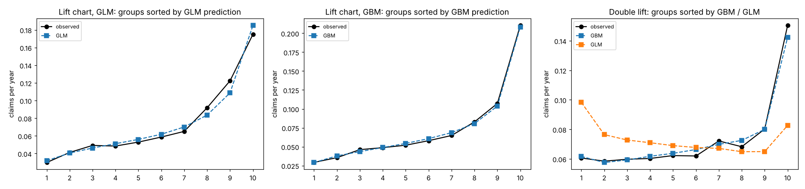
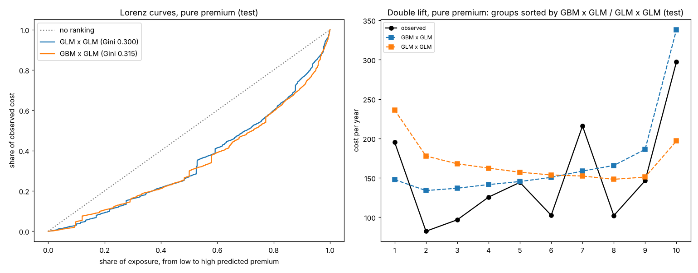

# Pricing motor insurance: frequency × severity on French MTPL data

A motor insurer must charge each policy its **pure premium**: the expected cost of its claims per
year. This repo estimates it on `freMTPL2`, a public French motor third-party liability (MTPL)
portfolio of 678,013 policies and 26,639 claims, with the standard actuarial decomposition:
**how often** a policy claims (frequency) times **how much** a claim costs (severity).

Everything is in one notebook, [`Motor_Insurance_Pricing.ipynb`](Motor_Insurance_Pricing.ipynb):
data cleaning, a Poisson GLM against gradient boosting (LightGBM) for the frequency, a Gamma GLM
for the severity, and the comparison of the resulting premiums on a test set. This README explains
the theory behind each step and summarises the results.

## Headline

| Test set (135,768 policies) | Frequency: Poisson deviance ↓ | Frequency: Gini ↑ | Pure premium: Gini ↑ |
|---|---:|---:|---:|
| same premium for everybody | 0.4767 | 0 | 0 |
| GLM | 0.4543 | 0.298 | 0.300 (GLM × GLM) |
| gradient boosting | **0.4457** | **0.331** | **0.315** (GBM × GLM) |

- **The raw claim counts are wrong for a block of 9,139 policies.** Rebuilding the claim counts from the claims table
  reproduces exactly the counts published by Wüthrich & Merz (2023): 678,007 policies, 26,383 claims.
- **Frequency: gradient boosting beats the GLM**, and where the two disagree the boosting is right
  (right panel below). A visible part of the gap is `BonusMalus`, whose effect is not log-linear.
- **Severity: there is almost nothing to learn.** In cross-validation neither a GLM nor a GBM removes
  more than a fraction of a percent of the deviance of the plain mean: the cost of a claim depends on
  the accident, which the data do not describe.



## The problem

For a policy with characteristics $x$ observed for $e$ years (the **exposure**), let $N$ be its
number of claims and $Y_1, \dots, Y_N$ their costs. The total cost is $S = \sum_{k=1}^{N} Y_k$ and the
pure premium is the expected cost per year:

$$
\pi(x) = \frac{\mathbb{E}[S \mid x]}{e} = \underbrace{\frac{\mathbb{E}[N \mid x]}{e}}_{\text{frequency } \lambda(x)} \times \underbrace{\mathbb{E}[Y \mid x]}_{\text{severity } \mu(x)} .
$$

The factorisation holds if, given $x$, the claim costs are identically distributed and independent of
the number of claims (Wald's identity). It lets us fit two simpler models, on two different datasets:
the frequency on all policies, the severity on the claims only.

## Frequency: Poisson with an exposure offset

The number of claims is modelled as $N \sim \text{Poisson}(\lambda(x)\, e)$: a policy observed for half a
year is expected to have half the claims of the same policy observed for a year. With a log link,

$$
\log \mathbb{E}[N \mid x] = \log e + \log \lambda(x), \qquad \log \lambda(x) = \beta_0 + \beta_1 x_1 + \dots
$$

The term $\log e$ has no coefficient: it is an **offset**, a known part of the linear predictor.

**Why not model the observed rate $N/e$ directly, with equal weights?** Because a policy observed for
2 days with one claim has a rate of 180 claims per year. In the Poisson likelihood it counts for what it
is, one claim in two days: with a single $\lambda$ the estimate is $\hat\lambda = \sum N_i / \sum e_i$,
and the information a policy carries is proportional to its exposure.

**The log link makes the tariff multiplicative.** Each coefficient becomes a **relativity**
$e^{\beta_j}$, the factor by which a characteristic multiplies the frequency with respect to a
reference level. This is how actuarial tariffs are written.

**The Poisson GLM is balanced.** With the log link (the canonical link of the Poisson family) the
maximum-likelihood equations are $X^\top (N - \hat\mu) = 0$; the row of the intercept says that the
total predicted claims equal the observed total on the training data, exactly. The notebook checks it.

**The deviance measures the fit.** For counts, the squared error is a poor measure: the variance grows
with the mean, and 96% of the policies have no claim. The Poisson deviance

$$
D = \frac{1}{\sum_i e_i} \sum_i 2 \left[ N_i \log \frac{N_i}{\hat\mu_i} - (N_i - \hat\mu_i) \right], \qquad \hat\mu_i = \hat\lambda(x_i)\, e_i ,
$$

is the loss the Poisson model minimises (lower is better). It cannot be zero: most of the variability
of claim counts is pure chance, which no model can predict. That is why the improvements look small
(a few percent): they are compared with that randomness.

## Gradient boosting

A gradient boosting machine (here LightGBM) adds hundreds of small decision trees, each one fitted to
correct the errors of the previous ones, minimising the same Poisson loss. Unlike a GLM it finds by
itself non-linear effects and interactions, and it uses the raw covariates.

The exposure is passed as the starting point of each policy (`init_score`), set to
$\log e + \log \hat\lambda_0$, where $\hat\lambda_0$ is the average frequency: the trees learn a
multiplicative correction to the average. Two practical points:
- LightGBM does **not** store `init_score` in the model: at prediction time the trees return only
  their correction, and the base frequency has to be put back by hand.
- The number of trees is chosen by early stopping on a validation part of the training set, never on
  the test set.

## Severity: Gamma with a log link, and large claims

Claim costs are positive and skewed, and their spread grows with their mean. The Gamma distribution
has exactly this property, $\operatorname{Var}(Y) = \phi\, \mu^2$ (a constant coefficient of
variation), and with a log link the severity tariff is multiplicative too.

**Large claims.** The largest 1% of claims carry 38% of the total cost, and the largest is 4 million. A
model fitted on raw amounts would mostly describe a handful of claims. Claims are therefore capped at
$u = 50{,}000$, the severity model is fitted on the capped amounts, and the cost above the cap is added
back to every claim as a **loading**:

$$
\text{expected cost per claim} = \hat\mu_{\text{capped}}(x) \times (1 + L), \qquad
L = \frac{\sum_k (Y_k - u)_+}{\sum_k \min(Y_k, u)} \quad \text{(on the training claims)} .
$$

The loading assumes that large claims are proportional to the "normal" severity of each profile: with
72 claims above the cap, how they depend on 8 covariates cannot be estimated.

**Cross-validation.** With about 21,000 noisy claims, one validation split is not enough to tell
whether a flexible model helps. The notebook compares the mean, the GLM and a GBM with 5-fold
cross-validation, measured by $D^2 = 1 - D_{\text{model}} / D_{\text{mean}}$, the share of the Gamma
deviance of the mean that a model removes.

## Pure premium, balance and how the models are compared

Each frequency model is multiplied by the severity GLM, applied to **every** policy (with or without
claims). Each resulting premium is then rescaled by a constant so that its total equals the total
observed cost **on the training set** (balance correction); the test set is never used to fit or
calibrate anything.

On the test set the premiums are compared with these tools:
- **Gini index.** Sort the policies from the lowest to the highest predicted premium and draw the
  share of observed cost against the share of exposure (the Lorenz curve). A model that ranks risks
  well puts little cost on the policies it rates lowest; the Gini index is $1 - 2 \times$ (area under the
  curve): 0 for no ranking, higher is better. It measures ranking only, not the level of the premium.
- **Balance**: total predicted / total observed cost.
- **Lift and double lift charts.** Cut the policies into 10 groups of equal exposure by predicted
  value (lift) or by the ratio of two models' predictions (double lift), and compare observed and
  predicted values in each group. In a double lift chart, where the two models disagree, the one whose
  line follows the observed one is right.
- The Tweedie deviance with power $p = 1.9$ (the distribution of a Poisson sum of Gamma claims, as in
  the scikit-learn example) is also reported for the pure premium.

## Why the train/test split is grouped

38% of the policies share all their characteristics with at least one other record: the same car
renewed during the year, fleets of identical cars. If two records of the same car land one in train and
one in test, the model has already seen that car, and the test score is optimistic (more for a GBM,
which can memorise exact combinations of covariates). The split therefore sends all policies with
identical covariates to the same side.

## The data, and what is wrong with them

The data come from the CASdatasets R package: the original 2017 release, with the same row counts as
the OpenML version used by the scikit-learn tutorial, downloaded by the notebook from a fixed commit of
the [GitHub repository](https://github.com/dutangc/CASdatasets). Three problems, three decisions:

| Problem | Evidence | Decision |
|---|---|---|
| The policy table counts 36,102 claims, the claims table 26,639 | All 9,139 policies with `IDpol` ≤ 24,500 have a claim in the policy table, almost none in the claims table | Claim counts rebuilt from the claims table; 195 claims without a policy dropped |
| A few policies have 6 to 16 claims | Mostly one car split over records of a few weeks | Policies with more than 5 claims dropped |
| 1,224 policies are exposed for more than one year | The portfolio is observed over one year | Exposure capped at 1 |

The result, **678,007 policies and 26,383 claims**, matches exactly the counts reported by
Wüthrich & Merz (2023, §13.1) after the same cleaning. `Area` is left out of the models: it is just
`Density` cut into six classes.

## Results

All on the test set, which the models never saw.

**Frequency** (claims per year):

| model | Poisson deviance | Gini | balance |
|---|---:|---:|---:|
| same frequency for everybody | 0.4767 | 0 | 1.003 |
| Poisson GLM | 0.4543 | 0.298 | 1.001 |
| LightGBM | **0.4457** | **0.331** | 1.001 |

**Severity** (capped cost per claim): $D^2$ of the Gamma GLM in 5-fold cross-validation 0.15% (the
folds range from −0.2% to +0.5%), of a small GBM −0.11%; on the test claims the GLM reaches 0.66%. The
scikit-learn tutorial finds 0.4% on the same data.

**Pure premium** (cost per year):

| model | Tweedie deviance (p = 1.9) | Gini | balance |
|---|---:|---:|---:|
| same premium for everybody | 34.53 | 0 | 1.13 |
| GLM frequency × GLM severity | 34.03 | 0.300 | 1.13 |
| GBM frequency × GLM severity | **33.97** | **0.315** | 1.13 |



### Do the models work?

Not "which one is better", but whether they work at all: on the test set, cut into 10 groups of equal
exposure from the lowest to the highest prediction (notebook §9).

| test set | riskiest 10% / safest 10% (observed) | largest error in a group | total predicted / observed |
|---|---:|---:|---:|
| frequency, GLM | 5.9× | 11% | 1.001 |
| frequency, GBM | 7.2× | 7% | 1.001 |
| pure premium, GLM × GLM, cost below 50,000 per claim | 6.5× | 14% | 1.001 |
| pure premium, GBM × GLM, cost below 50,000 per claim | 8.7× | 14% | 1.002 |

The frequency models separate the risks and get their level right. The severity model barely moves
away from the average cost per claim, which is all the data allow. Very large claims are predictable by
no model: they are covered on average by the loading, and they make one year's total cost uncertain.

**Every premium over-predicts the test cost by 13%**, the flat one included: the test set happens to
contain fewer very large claims than the training set (15% of its cost above the cap against 24%). This
is the large-claim loading meeting one year of heavy-tailed data, not a defect of the models.

## Limitations

- **One test year.** With large claims this volatile, the difference between the two premiums (Gini
  0.315 against 0.300) is within what another sample could reverse; a bootstrap of the test set or more
  years of data would be needed before choosing one for a real tariff.
- **No time dimension.** The data have no dates, so the models are tested on a random sample of the same
  year, not on the following one.
- **The loading is estimated on 72 claims**, and the frequency × severity split assumes that the cost
  of a claim does not depend on how many claims the policy had.

## Running it

```bash
pip install -r requirements.txt
jupyter notebook Motor_Insurance_Pricing.ipynb
```

The first run downloads the data (about 4 MB) into `data/` and converts them; the whole notebook then
runs in about a minute. Tested with Python 3.13, pandas 3.0, scikit-learn 1.9, statsmodels 0.15,
LightGBM 4.7.

## Data and licence

The code in this repo is MIT (see `LICENSE`). The data are **not** included: the notebook downloads
them from the CASdatasets package by C. Dutang and A. Charpentier, distributed under the GNU GPL
(version 2 or later). See `NOTICE.txt`.

This project was developed with the help of an AI assistant (Claude).

## References

- M. V. Wüthrich, M. Merz (2023). *Statistical Foundations of Actuarial Learning and its Applications*.
  Springer (open access). Section 13.1: the freMTPL2 data and their cleaning.
- scikit-learn example: *Tweedie regression on insurance claims* (same data).
- M. Goldburd, A. Khare, D. Tevet, D. Guller. *Generalized Linear Models for Insurance Rating*.
  CAS Monograph No. 5.
